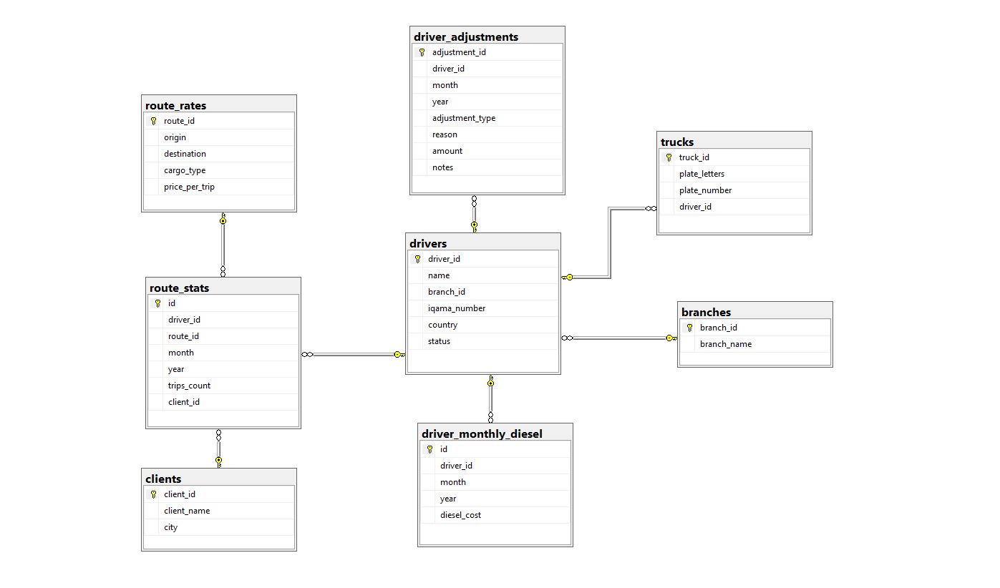
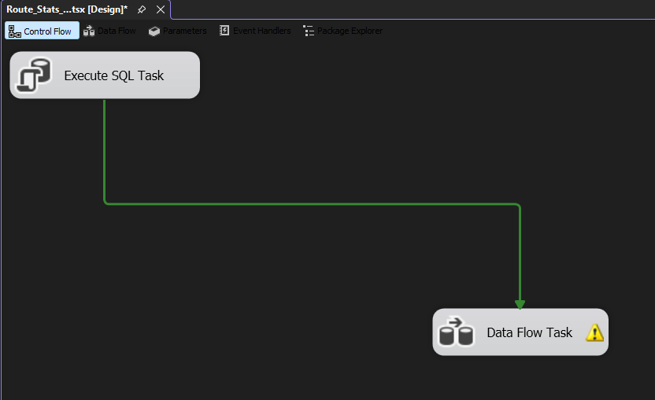
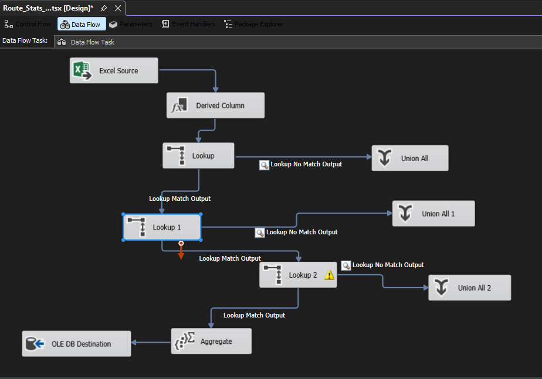
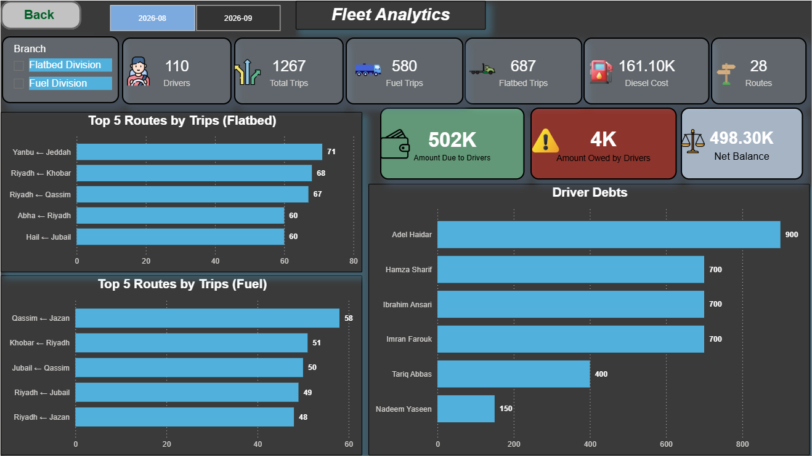
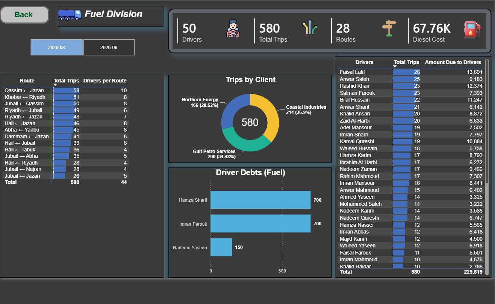
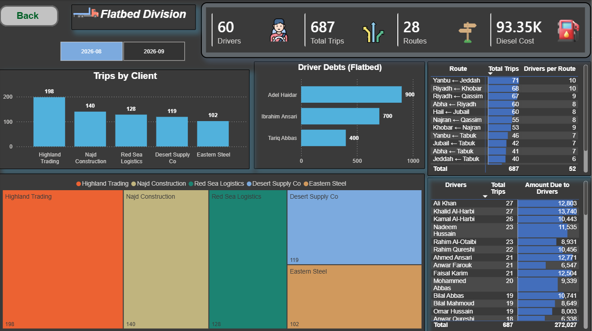

# Muwasil Fleet Analytics

End-to-end ETL and BI pipeline for a transportation company: **Excel → SSIS → SQL Server → Power BI**, with monthly driver dues and row-level security by branch and city.

> **Note on data:** This repository contains the schema, queries and SSIS packages only. The original data belongs to the company and is **not** included. Sample data in `data/sample/` is synthetic. Server names and file paths in the packages are placeholders (`YOUR_SERVER`, `C:\path\to\data\`).

## The problem

Operational data for a fleet of 100+ drivers across two branches (fuel transport and flatbed trucks) lived in separate Excel sheets: drivers, trucks, clients, routes, monthly trips, monthly diesel, and traffic fines / waiting-pay adjustments. There was no single source of truth, driver names were typed inconsistently, and monthly driver dues were calculated by hand.

## The solution

| Layer | Tool | What it does |
| --- | --- | --- |
| Source | Excel | Monthly sheets prepared by operations |
| ETL | SSIS | 8 packages load the sheets into SQL Server |
| Storage | SQL Server | Normalized schema with keys and constraints |
| Reporting | Power BI | Model, DAX measures, dashboards, Row-Level Security |

## Database design

Main tables: `branches`, `drivers`, `trucks`, `clients`, `route_rates`, `route_stats`, `driver_monthly_diesel`, `driver_adjustments`, `user_access`.

Design decisions:

- **Three loading patterns**, matched to how each table is used:
  - *Semi-static* tables (drivers, trucks, clients, route rates) are insert-only: new rows are added, existing rows are never wiped.
  - *Monthly snapshot* tables (`route_stats`, `driver_monthly_diesel`) delete the month and reload it, so a rerun never creates duplicates.
  - *Append-only log* (`driver_adjustments`): one row per event (fine, waiting pay), with a signed `amount` (negative = deduction), so dues need a single `SUM`.
- **Unique constraints** on the natural keys (for example driver + month + year for diesel) so bad loads fail loudly instead of silently duplicating.
- **Filtered unique index** on the residency number, so only non-empty values must be unique.

   

## SSIS packages

| Package | Purpose | Pattern |
| --- | --- | --- |
| `Drivers_Package` | Add new drivers | Insert only |
| `Trucks_Package` | Add new trucks | Insert only |
| `Clients_Package` | Add new clients | Insert only |
| `Route_Rates_Package` | Route prices | Semi-static |
| `Update_Driver_Truck` | Reassign a driver's truck | Update |
| `Route_Stats_Package` | Monthly trips | Delete month, reload |
| `Diesel_Package` | Monthly diesel | Delete month, reload |
| `Driver_Adjustments_Package` | Fines and waiting pay | Append only |

   Example: `Route_Stats_Package` deletes the month being reloaded, then loads it again, so reruns never duplicate rows.

   
   

   Rows that fail a Lookup (unknown driver, route or client) are routed to a separate output instead of being silently dropped, then validated with `sql/03_validation_checks.sql`.

## Challenges and solutions

**1. Silent row loss in Lookups.** SSIS Lookup matches text exactly. A single extra space in a driver name sent the row to the *No Match* output, and with nothing attached to that output the row was dropped without any error. One load wrote 62 of 109 diesel rows.
*Fix:* a Derived Column that trims and collapses repeated spaces before every Lookup that matches driver names:

```
TRIM(REPLACE(REPLACE(REPLACE(driver_name,"   "," "),"  "," "),"  "," "))
```

**2. Duplicate drivers.** The same whitespace mismatch made the Drivers package treat existing drivers as new and insert them again. The fix was applied at the root: the same cleaning now runs in every package that matches names against `drivers`, plus a de-duplication script and a validation query.

**3. Duplicate-key errors on reruns.** Running only the Data Flow skipped the Execute SQL Task that deletes the month. Packages are run from the Control Flow, and the month is cleared before each reload.

**4. Row multiplication in the dues query.** Joining a multi-row adjustments table directly to the trips join multiplied rows and inflated totals. Adjustments are now pre-aggregated per driver in a subquery before joining.

## Monthly dues

`sql/02_driver_dues.sql` calculates, per driver and month:

```
dues = trips × route rate − diesel + adjustments
```

Month filters sit in the `ON` clauses of `LEFT JOIN`s (not in `WHERE`), so drivers with no trips still appear.

`sql/03_validation_checks.sql` holds the post-load checks: driver counts, duplicate names, drivers without a branch, trips on unknown routes, loaded months, and drivers missing diesel for a month.

## Power BI

All screenshots use fully synthetic data.





- Star-style model with one-to-many relationships and a `Periods` table driving the month slicer.
- DAX measures for trips value, diesel, adjustments and net dues.
- **Row-Level Security** driven by a `user_access` table:
  - Admin and Manager see everything.
  - Delegates see only their branch and only routes that start or end in their city.
  - New users are added with a row in the table, no report changes needed.

## Monthly run order

1. Run only the packages whose source sheet changed (new drivers, trucks, clients, route rates).
2. `Route_Stats_Package`
3. `Diesel_Package`
4. `Driver_Adjustments_Package`, only if there are fines or additions this month; clear the sheet afterwards.
5. Run `sql/03_validation_checks.sql`.
6. Refresh the Power BI semantic model.

## Repository structure

```
├── sql/        schema, dues query, validation checks
├── ssis/       SSIS project (8 packages)
├── data/       synthetic sample data
└── docs/       dashboard screenshots
```

## Setup

1. Create an empty database in SQL Server and run `sql/01_create_tables.sql` on it.
2. Load the synthetic data: run `data/sample/sample_data.sql` (it is generated by `data/generate_sample_data.py`).
3. Run `sql/02_driver_dues.sql` to see monthly dues, then `sql/03_validation_checks.sql`.
4. Optional: open `ssis/muwasil_etl` in Visual Studio with SSIS support and point the connection managers to your server and your own Excel files.

## Tech

SQL Server · T-SQL · SSIS · Power BI (DAX, RLS) · Excel
